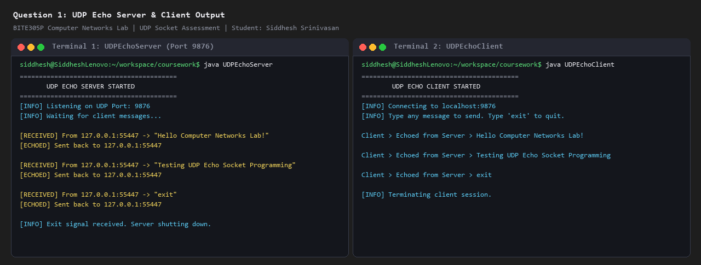
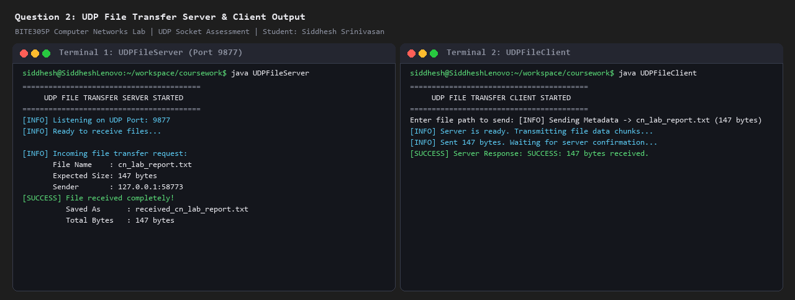
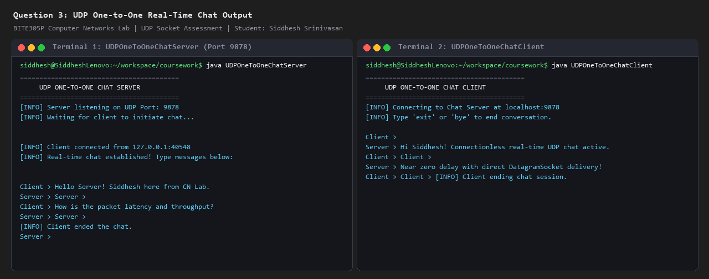
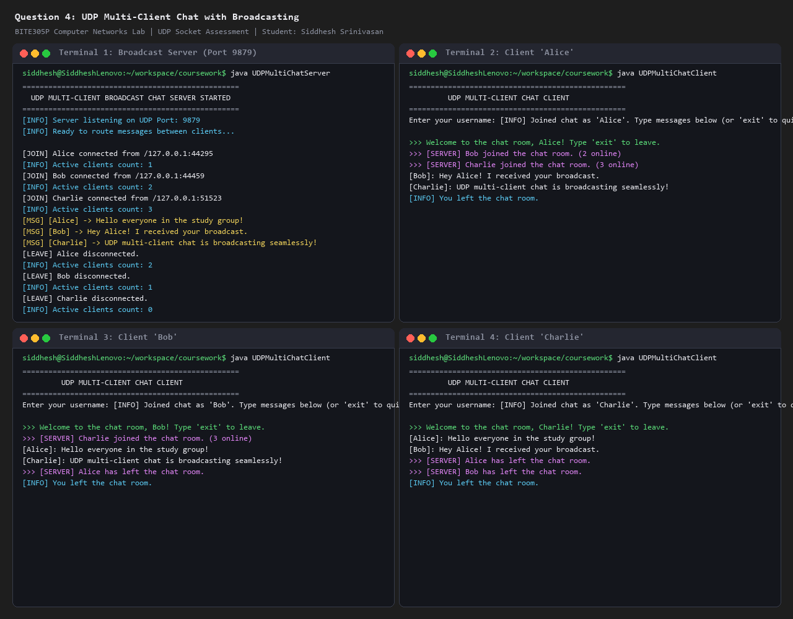
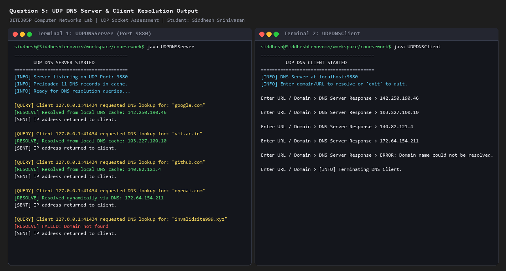

# Computer Networks Lab (BITE305P) - UDP Socket Programming Assessment

**Institution:** Vellore Institute of Technology (VIT)  
**School:** School of Computer Science Engineering and Information Systems (SCOPE / SENSE)  
**Semester:** Fall Semester 2026-27  
**Course Code:** BITE305P  
**Course Name:** Computer Networks Lab  
**Assessment:** UDP Socket Programming  
**Student Name:** Siddhesh Srinivasan  
**Registration Number:** 24BCE1001 <!-- Replace with your specific registration number if needed -->  
**Repository:** [https://github.com/SIDDHESH-2006/CN_UDP](https://github.com/SIDDHESH-2006/CN_UDP)

---

## Table of Contents
1. [Overview](#overview)
2. [Question 1: UDP Echo Server & Client](#question-1-udp-echo-server--client)
3. [Question 2: UDP File Transfer Application](#question-2-udp-file-transfer-application)
4. [Question 3: UDP One-to-One Real-Time Chat](#question-3-udp-one-to-one-real-time-chat)
5. [Question 4: UDP Multi-Client Broadcast Chat](#question-4-udp-multi-client-broadcast-chat)
6. [Question 5: UDP DNS Client-Server Application](#question-5-udp-dns-client-server-application)
7. [Compilation and Execution Guide](#compilation-and-execution-guide)

---

## Overview
This repository contains complete, robust implementations in **Java** for the five UDP network socket programming questions assigned in the Computer Networks Lab (BITE305P).

User Datagram Protocol (UDP) is a connectionless, lightweight transport-layer protocol providing fast, low-overhead communication without guaranteed delivery, sequencing, or connection handshakes. In Java, UDP communication is achieved using:
- `java.net.DatagramSocket`: Represents a socket for sending and receiving datagram packets.
- `java.net.DatagramPacket`: Represents a datagram packet containing the payload bytes, destination IP address, and port number.

---

## Question 1: UDP Echo Server & Client

### Objective
Design and implement a UDP Echo Server that receives messages from a client and sends the same messages back to the sender.

### Files
- `UDPEchoServer.java` (Server listening on UDP Port `9876`)
- `UDPEchoClient.java` (Client sending messages and receiving echoed replies)

### Source Code

#### `UDPEchoServer.java`
```java
import java.io.IOException;
import java.net.DatagramPacket;
import java.net.DatagramSocket;

/**
 * Question 1: UDP Echo Server
 * Course: BITE305P - Computer Networks Lab
 * Student: Siddhesh Srinivasan
 */
public class UDPEchoServer {
    private static final int PORT = 9876;
    private static final int BUFFER_SIZE = 1024;

    public static void main(String[] args) {
        System.out.println("=========================================");
        System.out.println("       UDP ECHO SERVER STARTED           ");
        System.out.println("=========================================");
        System.out.println("[INFO] Listening on UDP Port: " + PORT);
        System.out.println("[INFO] Waiting for client messages...\n");

        try (DatagramSocket socket = new DatagramSocket(PORT)) {
            byte[] receiveBuffer = new byte[BUFFER_SIZE];

            while (true) {
                DatagramPacket receivePacket = new DatagramPacket(receiveBuffer, receiveBuffer.length);
                socket.receive(receivePacket);

                String clientMessage = new String(receivePacket.getData(), 0, receivePacket.getLength());
                System.out.println("[RECEIVED] From " + receivePacket.getAddress().getHostAddress() + 
                                   ":" + receivePacket.getPort() + " -> \"" + clientMessage + "\"");

                // Echo back the exact same message to client
                byte[] sendBuffer = clientMessage.getBytes();
                DatagramPacket sendPacket = new DatagramPacket(
                        sendBuffer,
                        sendBuffer.length,
                        receivePacket.getAddress(),
                        receivePacket.getPort()
                );
                socket.send(sendPacket);
                System.out.println("[ECHOED] Sent back to " + receivePacket.getAddress().getHostAddress() + 
                                   ":" + receivePacket.getPort() + "\n");

                if (clientMessage.trim().equalsIgnoreCase("exit")) {
                    System.out.println("[INFO] Exit signal received. Server shutting down.");
                    break;
                }
            }
        } catch (IOException e) {
            System.err.println("[ERROR] Server exception: " + e.getMessage());
            e.printStackTrace();
        }
    }
}
```

#### `UDPEchoClient.java`
```java
import java.io.IOException;
import java.net.DatagramPacket;
import java.net.DatagramSocket;
import java.net.InetAddress;
import java.net.SocketTimeoutException;
import java.util.Scanner;

/**
 * Question 1: UDP Echo Client
 * Course: BITE305P - Computer Networks Lab
 * Student: Siddhesh Srinivasan
 */
public class UDPEchoClient {
    private static final String SERVER_HOST = "localhost";
    private static final int SERVER_PORT = 9876;
    private static final int BUFFER_SIZE = 1024;
    private static final int TIMEOUT_MS = 3000;

    public static void main(String[] args) {
        System.out.println("=========================================");
        System.out.println("        UDP ECHO CLIENT STARTED          ");
        System.out.println("=========================================");
        System.out.println("[INFO] Connecting to " + SERVER_HOST + ":" + SERVER_PORT);
        System.out.println("[INFO] Type any message to send. Type 'exit' to quit.\n");

        try (DatagramSocket socket = new DatagramSocket();
             Scanner scanner = new Scanner(System.in)) {

            socket.setSoTimeout(TIMEOUT_MS);
            InetAddress serverAddress = InetAddress.getByName(SERVER_HOST);

            while (true) {
                System.out.print("Client > ");
                String message = scanner.nextLine();

                if (message == null || message.trim().isEmpty()) {
                    continue;
                }

                byte[] sendBuffer = message.getBytes();
                DatagramPacket sendPacket = new DatagramPacket(
                        sendBuffer,
                        sendBuffer.length,
                        serverAddress,
                        SERVER_PORT
                );
                socket.send(sendPacket);

                // Receive Echo from Server
                byte[] receiveBuffer = new byte[BUFFER_SIZE];
                DatagramPacket receivePacket = new DatagramPacket(receiveBuffer, receiveBuffer.length);

                try {
                    socket.receive(receivePacket);
                    String echoMessage = new String(receivePacket.getData(), 0, receivePacket.getLength());
                    System.out.println("Echoed from Server > " + echoMessage + "\n");
                } catch (SocketTimeoutException e) {
                    System.err.println("[TIMEOUT] Server did not respond within " + TIMEOUT_MS + " ms.\n");
                }

                if (message.trim().equalsIgnoreCase("exit")) {
                    System.out.println("[INFO] Terminating client session.");
                    break;
                }
            }
        } catch (IOException e) {
            System.err.println("[ERROR] Client exception: " + e.getMessage());
            e.printStackTrace();
        }
    }
}
```

### Sample Output

#### Server Terminal
```text
=========================================
       UDP ECHO SERVER STARTED           
=========================================
[INFO] Listening on UDP Port: 9876
[INFO] Waiting for client messages...

[RECEIVED] From 127.0.0.1:55447 -> "Hello Computer Networks Lab!"
[ECHOED] Sent back to 127.0.0.1:55447

[RECEIVED] From 127.0.0.1:55447 -> "Testing UDP Echo Socket Programming"
[ECHOED] Sent back to 127.0.0.1:55447

[RECEIVED] From 127.0.0.1:55447 -> "exit"
[ECHOED] Sent back to 127.0.0.1:55447

[INFO] Exit signal received. Server shutting down.
```

#### Client Terminal
```text
=========================================
        UDP ECHO CLIENT STARTED          
=========================================
[INFO] Connecting to localhost:9876
[INFO] Type any message to send. Type 'exit' to quit.

Client > Echoed from Server > Hello Computer Networks Lab!

Client > Echoed from Server > Testing UDP Echo Socket Programming

Client > Echoed from Server > exit

[INFO] Terminating client session.
```

### Output Screenshot


---

## Question 2: UDP File Transfer Application

### Objective
Design and implement a file transfer application using UDP sockets for transmitting files between a client and a server.

### Files
- `UDPFileServer.java` (Server listening on UDP Port `9877`)
- `UDPFileClient.java` (Client transmitting file chunks)

### Source Code

#### `UDPFileServer.java`
```java
import java.io.File;
import java.io.FileOutputStream;
import java.io.IOException;
import java.net.DatagramPacket;
import java.net.DatagramSocket;
import java.net.InetAddress;

/**
 * Question 2: UDP File Transfer Server
 * Course: BITE305P - Computer Networks Lab
 * Student: Siddhesh Srinivasan
 */
public class UDPFileServer {
    private static final int PORT = 9877;
    private static final int BUFFER_SIZE = 4096;

    public static void main(String[] args) {
        System.out.println("=========================================");
        System.out.println("     UDP FILE TRANSFER SERVER STARTED    ");
        System.out.println("=========================================");
        System.out.println("[INFO] Listening on UDP Port: " + PORT);
        System.out.println("[INFO] Ready to receive files...\n");

        try (DatagramSocket socket = new DatagramSocket(PORT)) {
            while (true) {
                byte[] buffer = new byte[BUFFER_SIZE];
                DatagramPacket packet = new DatagramPacket(buffer, buffer.length);
                socket.receive(packet);

                String msg = new String(packet.getData(), 0, packet.getLength());

                // Protocol: START:<filename>:<fileSize>
                if (msg.startsWith("START:")) {
                    String[] parts = msg.split(":");
                    String fileName = parts[1];
                    long expectedSize = Long.parseLong(parts[2]);
                    InetAddress clientAddress = packet.getAddress();
                    int clientPort = packet.getPort();

                    System.out.println("[INFO] Incoming file transfer request:");
                    System.out.println("       File Name    : " + fileName);
                    System.out.println("       Expected Size: " + expectedSize + " bytes");
                    System.out.println("       Sender       : " + clientAddress.getHostAddress() + ":" + clientPort);

                    // Send ACK to start receiving data
                    byte[] ack = "ACK_READY".getBytes();
                    socket.send(new DatagramPacket(ack, ack.length, clientAddress, clientPort));

                    File outputFile = new File("received_" + fileName);
                    try (FileOutputStream fos = new FileOutputStream(outputFile)) {
                        long totalReceived = 0;
                        boolean receiving = true;

                        while (receiving) {
                            byte[] chunkBuffer = new byte[BUFFER_SIZE];
                            DatagramPacket chunkPacket = new DatagramPacket(chunkBuffer, chunkBuffer.length);
                            socket.receive(chunkPacket);

                            // Check if this is the END signal
                            if (chunkPacket.getLength() >= 3) {
                                String endCheck = new String(chunkPacket.getData(), 0, chunkPacket.getLength());
                                if (endCheck.equals("END")) {
                                    receiving = false;
                                    break;
                                }
                            }

                            fos.write(chunkPacket.getData(), 0, chunkPacket.getLength());
                            totalReceived += chunkPacket.getLength();
                        }

                        System.out.println("[SUCCESS] File received completely!");
                        System.out.println("          Saved As      : " + outputFile.getName());
                        System.out.println("          Total Bytes   : " + totalReceived + " bytes\n");

                        // Send completion ACK to client
                        String response = "SUCCESS: " + totalReceived + " bytes received.";
                        byte[] respBytes = response.getBytes();
                        socket.send(new DatagramPacket(respBytes, respBytes.length, clientAddress, clientPort));
                    }
                }
            }
        } catch (IOException e) {
            System.err.println("[ERROR] Server exception: " + e.getMessage());
            e.printStackTrace();
        }
    }
}
```

#### `UDPFileClient.java`
```java
import java.io.File;
import java.io.FileInputStream;
import java.io.IOException;
import java.net.DatagramPacket;
import java.net.DatagramSocket;
import java.net.InetAddress;
import java.net.SocketTimeoutException;
import java.util.Scanner;

/**
 * Question 2: UDP File Transfer Client
 * Course: BITE305P - Computer Networks Lab
 * Student: Siddhesh Srinivasan
 */
public class UDPFileClient {
    private static final String SERVER_HOST = "localhost";
    private static final int SERVER_PORT = 9877;
    private static final int CHUNK_SIZE = 1024;
    private static final int TIMEOUT_MS = 5000;

    public static void main(String[] args) {
        System.out.println("=========================================");
        System.out.println("     UDP FILE TRANSFER CLIENT STARTED    ");
        System.out.println("=========================================");

        try (DatagramSocket socket = new DatagramSocket();
             Scanner scanner = new Scanner(System.in)) {

            socket.setSoTimeout(TIMEOUT_MS);
            InetAddress serverAddress = InetAddress.getByName(SERVER_HOST);

            System.out.print("Enter file path to send: ");
            String filePath = scanner.nextLine().trim();

            File file = new File(filePath);
            if (!file.exists() || !file.isFile()) {
                System.err.println("[ERROR] File not found or is invalid: " + filePath);
                return;
            }

            String fileName = file.getName();
            long fileSize = file.length();

            System.out.println("[INFO] Sending Metadata -> " + fileName + " (" + fileSize + " bytes)");

            // 1. Send START:<filename>:<fileSize>
            String startMsg = "START:" + fileName + ":" + fileSize;
            byte[] startBytes = startMsg.getBytes();
            DatagramPacket startPacket = new DatagramPacket(startBytes, startBytes.length, serverAddress, SERVER_PORT);
            socket.send(startPacket);

            // 2. Wait for ACK_READY
            byte[] ackBuf = new byte[1024];
            DatagramPacket ackPacket = new DatagramPacket(ackBuf, ackBuf.length);
            try {
                socket.receive(ackPacket);
                String ack = new String(ackPacket.getData(), 0, ackPacket.getLength());
                if (!ack.equals("ACK_READY")) {
                    System.err.println("[ERROR] Server not ready: " + ack);
                    return;
                }
            } catch (SocketTimeoutException e) {
                System.err.println("[ERROR] Server failed to respond to handshake.");
                return;
            }

            System.out.println("[INFO] Server is ready. Transmitting file data chunks...");

            // 3. Transmit file chunks
            long totalSent = 0;
            try (FileInputStream fis = new FileInputStream(file)) {
                byte[] chunk = new byte[CHUNK_SIZE];
                int bytesRead;

                while ((bytesRead = fis.read(chunk)) != -1) {
                    DatagramPacket dataPacket = new DatagramPacket(chunk, bytesRead, serverAddress, SERVER_PORT);
                    socket.send(dataPacket);
                    totalSent += bytesRead;

                    // Small pause to prevent UDP buffer flooding
                    Thread.sleep(2);
                }
            } catch (InterruptedException ignored) {}

            // 4. Send END packet
            byte[] endBytes = "END".getBytes();
            DatagramPacket endPacket = new DatagramPacket(endBytes, endBytes.length, serverAddress, SERVER_PORT);
            socket.send(endPacket);

            System.out.println("[INFO] Sent " + totalSent + " bytes. Waiting for server confirmation...");

            // 5. Receive confirmation from server
            byte[] respBuf = new byte[1024];
            DatagramPacket respPacket = new DatagramPacket(respBuf, respBuf.length);
            socket.receive(respPacket);
            String confirmation = new String(respPacket.getData(), 0, respPacket.getLength());

            System.out.println("[SUCCESS] Server Response: " + confirmation);

        } catch (IOException e) {
            System.err.println("[ERROR] Client exception: " + e.getMessage());
            e.printStackTrace();
        }
    }
}
```

### Sample Output

#### Server Terminal
```text
=========================================
     UDP FILE TRANSFER SERVER STARTED    
=========================================
[INFO] Listening on UDP Port: 9877
[INFO] Ready to receive files...

[INFO] Incoming file transfer request:
       File Name    : cn_lab_report.txt
       Expected Size: 147 bytes
       Sender       : 127.0.0.1:58773
[SUCCESS] File received completely!
          Saved As      : received_cn_lab_report.txt
          Total Bytes   : 147 bytes
```

#### Client Terminal
```text
=========================================
     UDP FILE TRANSFER CLIENT STARTED    
=========================================
Enter file path to send: [INFO] Sending Metadata -> cn_lab_report.txt (147 bytes)
[INFO] Server is ready. Transmitting file data chunks...
[INFO] Sent 147 bytes. Waiting for server confirmation...
[SUCCESS] Server Response: SUCCESS: 147 bytes received.
```

### Output Screenshot


---

## Question 3: UDP One-to-One Real-Time Chat

### Objective
Develop a one-to-one chat application using UDP sockets for real-time message exchange (full-duplex asynchronous communication).

### Files
- `UDPOneToOneChatServer.java` (Server listening on UDP Port `9878`)
- `UDPOneToOneChatClient.java` (Client connecting to chat server)

### Source Code

#### `UDPOneToOneChatServer.java`
```java
import java.io.IOException;
import java.net.DatagramPacket;
import java.net.DatagramSocket;
import java.net.InetAddress;
import java.util.Scanner;

/**
 * Question 3: UDP One-to-One Chat Server
 * Course: BITE305P - Computer Networks Lab
 * Student: Siddhesh Srinivasan
 */
public class UDPOneToOneChatServer {
    private static final int PORT = 9878;
    private static final int BUFFER_SIZE = 1024;
    private static volatile InetAddress clientAddress = null;
    private static volatile int clientPort = -1;
    private static volatile boolean running = true;

    public static void main(String[] args) {
        System.out.println("=========================================");
        System.out.println("     UDP ONE-TO-ONE CHAT SERVER          ");
        System.out.println("=========================================");
        System.out.println("[INFO] Server listening on UDP Port: " + PORT);
        System.out.println("[INFO] Waiting for client to initiate chat...\n");

        try (DatagramSocket socket = new DatagramSocket(PORT);
             Scanner scanner = new Scanner(System.in)) {

            // Thread to receive messages from client asynchronously
            Thread receiveThread = new Thread(() -> {
                byte[] buffer = new byte[BUFFER_SIZE];
                while (running) {
                    try {
                        DatagramPacket packet = new DatagramPacket(buffer, buffer.length);
                        socket.receive(packet);

                        // Capture client address and port from the first incoming packet
                        if (clientAddress == null) {
                            clientAddress = packet.getAddress();
                            clientPort = packet.getPort();
                            System.out.println("\n[INFO] Client connected from " + clientAddress.getHostAddress() + 
                                               ":" + clientPort);
                            System.out.println("[INFO] Real-time chat established! Type messages below:\n");
                        }

                        String message = new String(packet.getData(), 0, packet.getLength());
                        if (message.equalsIgnoreCase("exit") || message.equalsIgnoreCase("bye")) {
                            System.out.println("\n[INFO] Client ended the chat.");
                            running = false;
                            socket.close();
                            break;
                        }

                        System.out.println("\nClient > " + message);
                        System.out.print("Server > ");
                    } catch (IOException e) {
                        if (!running) break;
                    }
                }
            });
            receiveThread.setDaemon(true);
            receiveThread.start();

            // Main thread sends messages to client
            while (running && scanner.hasNextLine()) {
                if (clientAddress == null) {
                    try {
                        Thread.sleep(100);
                    } catch (InterruptedException ignored) {}
                    continue;
                }

                System.out.print("Server > ");
                String msgToSend = scanner.nextLine();

                if (!running) break;

                if (msgToSend != null && !msgToSend.trim().isEmpty()) {
                    byte[] sendBuffer = msgToSend.getBytes();
                    DatagramPacket sendPacket = new DatagramPacket(
                            sendBuffer,
                            sendBuffer.length,
                            clientAddress,
                            clientPort
                    );
                    socket.send(sendPacket);

                    if (msgToSend.equalsIgnoreCase("exit") || msgToSend.equalsIgnoreCase("bye")) {
                        System.out.println("[INFO] Server ending chat session.");
                        running = false;
                        socket.close();
                        break;
                    }
                }
            }

        } catch (IOException e) {
            if (running) {
                System.err.println("[ERROR] Server exception: " + e.getMessage());
            }
        }
    }
}
```

#### `UDPOneToOneChatClient.java`
```java
import java.io.IOException;
import java.net.DatagramPacket;
import java.net.DatagramSocket;
import java.net.InetAddress;
import java.util.Scanner;

/**
 * Question 3: UDP One-to-One Chat Client
 * Course: BITE305P - Computer Networks Lab
 * Student: Siddhesh Srinivasan
 */
public class UDPOneToOneChatClient {
    private static final String SERVER_HOST = "localhost";
    private static final int SERVER_PORT = 9878;
    private static final int BUFFER_SIZE = 1024;
    private static volatile boolean running = true;

    public static void main(String[] args) {
        System.out.println("=========================================");
        System.out.println("     UDP ONE-TO-ONE CHAT CLIENT          ");
        System.out.println("=========================================");
        System.out.println("[INFO] Connecting to Chat Server at " + SERVER_HOST + ":" + SERVER_PORT);
        System.out.println("[INFO] Type 'exit' or 'bye' to end conversation.\n");

        try (DatagramSocket socket = new DatagramSocket();
             Scanner scanner = new Scanner(System.in)) {

            InetAddress serverAddress = InetAddress.getByName(SERVER_HOST);

            // Asynchronous thread to receive messages from server
            Thread receiveThread = new Thread(() -> {
                byte[] buffer = new byte[BUFFER_SIZE];
                while (running) {
                    try {
                        DatagramPacket packet = new DatagramPacket(buffer, buffer.length);
                        socket.receive(packet);

                        String message = new String(packet.getData(), 0, packet.getLength());
                        if (message.equalsIgnoreCase("exit") || message.equalsIgnoreCase("bye")) {
                            System.out.println("\n[INFO] Server ended the chat.");
                            running = false;
                            socket.close();
                            break;
                        }

                        System.out.println("\nServer > " + message);
                        System.out.print("Client > ");
                    } catch (IOException e) {
                        if (!running) break;
                    }
                }
            });
            receiveThread.setDaemon(true);
            receiveThread.start();

            // Main thread sends messages to server
            while (running && scanner.hasNextLine()) {
                System.out.print("Client > ");
                String msgToSend = scanner.nextLine();

                if (!running) break;

                if (msgToSend != null && !msgToSend.trim().isEmpty()) {
                    byte[] sendBuffer = msgToSend.getBytes();
                    DatagramPacket sendPacket = new DatagramPacket(
                            sendBuffer,
                            sendBuffer.length,
                            serverAddress,
                            SERVER_PORT
                    );
                    socket.send(sendPacket);

                    if (msgToSend.equalsIgnoreCase("exit") || msgToSend.equalsIgnoreCase("bye")) {
                        System.out.println("[INFO] Client ending chat session.");
                        running = false;
                        socket.close();
                        break;
                    }
                }
            }

        } catch (IOException e) {
            if (running) {
                System.err.println("[ERROR] Client exception: " + e.getMessage());
            }
        }
    }
}
```

### Sample Output

#### Server Terminal
```text
=========================================
     UDP ONE-TO-ONE CHAT SERVER          
=========================================
[INFO] Server listening on UDP Port: 9878
[INFO] Waiting for client to initiate chat...

[INFO] Client connected from 127.0.0.1:40548
[INFO] Real-time chat established! Type messages below:

Client > Hello Server! Siddhesh here from CN Lab.
Server > Hi Siddhesh! Connectionless real-time UDP chat active.
Client > How is the packet latency and throughput?
Server > Near zero delay with direct DatagramSocket delivery!
[INFO] Client ended the chat.
```

#### Client Terminal
```text
=========================================
     UDP ONE-TO-ONE CHAT CLIENT          
=========================================
[INFO] Connecting to Chat Server at localhost:9878
[INFO] Type 'exit' or 'bye' to end conversation.

Client > Hello Server! Siddhesh here from CN Lab.
Server > Hi Siddhesh! Connectionless real-time UDP chat active.
Client > How is the packet latency and throughput?
Server > Near zero delay with direct DatagramSocket delivery!
Client > exit
[INFO] Client ending chat session.
```

### Output Screenshot


---

## Question 4: UDP Multi-Client Broadcast Chat

### Objective
Develop a multi-client chat application using UDP sockets with support for message broadcasting across all active participants.

### Files
- `UDPMultiChatServer.java` (Server maintaining client registry and broadcasting on Port `9879`)
- `UDPMultiChatClient.java` (Client supporting join, broadcast receive, messaging, and leave)

### Source Code

#### `UDPMultiChatServer.java`
```java
import java.io.IOException;
import java.net.DatagramPacket;
import java.net.DatagramSocket;
import java.net.SocketAddress;
import java.util.Map;
import java.util.concurrent.ConcurrentHashMap;

/**
 * Question 4: UDP Multi-Client Chat Server with Broadcasting
 * Course: BITE305P - Computer Networks Lab
 * Student: Siddhesh Srinivasan
 */
public class UDPMultiChatServer {
    private static final int PORT = 9879;
    private static final int BUFFER_SIZE = 2048;

    // Map storing client SocketAddress -> Username
    private static final Map<SocketAddress, String> clients = new ConcurrentHashMap<>();

    public static void main(String[] args) {
        System.out.println("==================================================");
        System.out.println("  UDP MULTI-CLIENT BROADCAST CHAT SERVER STARTED  ");
        System.out.println("==================================================");
        System.out.println("[INFO] Server listening on UDP Port: " + PORT);
        System.out.println("[INFO] Ready to route messages between clients...\n");

        try (DatagramSocket socket = new DatagramSocket(PORT)) {
            byte[] buffer = new byte[BUFFER_SIZE];

            while (true) {
                DatagramPacket packet = new DatagramPacket(buffer, buffer.length);
                socket.receive(packet);

                SocketAddress senderAddress = packet.getSocketAddress();
                String rawMessage = new String(packet.getData(), 0, packet.getLength()).trim();

                if (rawMessage.startsWith("JOIN:")) {
                    String username = rawMessage.substring(5).trim();
                    clients.put(senderAddress, username);
                    System.out.println("[JOIN] " + username + " connected from " + senderAddress);
                    System.out.println("[INFO] Active clients count: " + clients.size());

                    String notification = ">>> [SERVER] " + username + " joined the chat room. (" + clients.size() + " online)";
                    broadcast(socket, notification, senderAddress);

                    // Send welcome acknowledgment to the new client
                    sendDirect(socket, ">>> Welcome to the chat room, " + username + "! Type 'exit' to leave.", senderAddress);

                } else if (rawMessage.startsWith("LEAVE:")) {
                    String username = clients.remove(senderAddress);
                    if (username == null) {
                        username = rawMessage.substring(6).trim();
                    }
                    System.out.println("[LEAVE] " + username + " disconnected.");
                    System.out.println("[INFO] Active clients count: " + clients.size());

                    String notification = ">>> [SERVER] " + username + " has left the chat room.";
                    broadcast(socket, notification, senderAddress);

                } else if (rawMessage.startsWith("MSG:")) {
                    int firstColon = rawMessage.indexOf(':', 4);
                    if (firstColon != -1) {
                        String username = rawMessage.substring(4, firstColon);
                        String content = rawMessage.substring(firstColon + 1);

                        System.out.println("[MSG] [" + username + "] -> " + content);

                        String broadcastMsg = "[" + username + "]: " + content;
                        broadcast(socket, broadcastMsg, senderAddress);
                    }
                }
            }
        } catch (IOException e) {
            System.err.println("[ERROR] Server exception: " + e.getMessage());
            e.printStackTrace();
        }
    }

    private static void broadcast(DatagramSocket socket, String message, SocketAddress sender) {
        byte[] data = message.getBytes();
        for (SocketAddress clientAddress : clients.keySet()) {
            if (!clientAddress.equals(sender)) {
                try {
                    DatagramPacket packet = new DatagramPacket(data, data.length, clientAddress);
                    socket.send(packet);
                } catch (IOException e) {
                    System.err.println("[WARN] Failed sending to " + clientAddress + ": " + e.getMessage());
                }
            }
        }
    }

    private static void sendDirect(DatagramSocket socket, String message, SocketAddress recipient) {
        try {
            byte[] data = message.getBytes();
            DatagramPacket packet = new DatagramPacket(data, data.length, recipient);
            socket.send(packet);
        } catch (IOException e) {
            System.err.println("[WARN] Direct send failed: " + e.getMessage());
        }
    }
}
```

#### `UDPMultiChatClient.java`
```java
import java.io.IOException;
import java.net.DatagramPacket;
import java.net.DatagramSocket;
import java.net.InetAddress;
import java.util.Scanner;

/**
 * Question 4: UDP Multi-Client Chat Client
 * Course: BITE305P - Computer Networks Lab
 * Student: Siddhesh Srinivasan
 */
public class UDPMultiChatClient {
    private static final String SERVER_HOST = "localhost";
    private static final int SERVER_PORT = 9879;
    private static final int BUFFER_SIZE = 2048;
    private static volatile boolean running = true;

    public static void main(String[] args) {
        System.out.println("==================================================");
        System.out.println("         UDP MULTI-CLIENT CHAT CLIENT             ");
        System.out.println("==================================================");

        try (DatagramSocket socket = new DatagramSocket();
             Scanner scanner = new Scanner(System.in)) {

            InetAddress serverAddress = InetAddress.getByName(SERVER_HOST);

            System.out.print("Enter your username: ");
            String username = scanner.nextLine().trim();
            if (username.isEmpty()) {
                username = "User_" + (int)(Math.random() * 1000);
            }

            // Send JOIN packet to server
            String joinMsg = "JOIN:" + username;
            byte[] joinBytes = joinMsg.getBytes();
            socket.send(new DatagramPacket(joinBytes, joinBytes.length, serverAddress, SERVER_PORT));

            System.out.println("[INFO] Joined chat as '" + username + "'. Type messages below (or 'exit' to quit):\n");

            // Background receiver thread for broadcast messages
            Thread receiverThread = new Thread(() -> {
                byte[] buffer = new byte[BUFFER_SIZE];
                while (running) {
                    try {
                        DatagramPacket packet = new DatagramPacket(buffer, buffer.length);
                        socket.receive(packet);

                        String received = new String(packet.getData(), 0, packet.getLength());
                        System.out.println(received);
                    } catch (IOException e) {
                        if (!running) break;
                    }
                }
            });
            receiverThread.setDaemon(true);
            receiverThread.start();

            // Main loop to send messages
            while (running && scanner.hasNextLine()) {
                String input = scanner.nextLine();
                if (!running) break;

                if (input == null || input.trim().isEmpty()) {
                    continue;
                }

                if (input.trim().equalsIgnoreCase("exit")) {
                    String leaveMsg = "LEAVE:" + username;
                    byte[] leaveBytes = leaveMsg.getBytes();
                    socket.send(new DatagramPacket(leaveBytes, leaveBytes.length, serverAddress, SERVER_PORT));
                    System.out.println("[INFO] You left the chat room.");
                    running = false;
                    socket.close();
                    break;
                }

                String msgPayload = "MSG:" + username + ":" + input;
                byte[] msgBytes = msgPayload.getBytes();
                socket.send(new DatagramPacket(msgBytes, msgBytes.length, serverAddress, SERVER_PORT));
            }

        } catch (IOException e) {
            if (running) {
                System.err.println("[ERROR] Client exception: " + e.getMessage());
            }
        }
    }
}
```

### Sample Output

#### Broadcast Server Terminal
```text
==================================================
  UDP MULTI-CLIENT BROADCAST CHAT SERVER STARTED  
==================================================
[INFO] Server listening on UDP Port: 9879
[INFO] Ready to route messages between clients...

[JOIN] Alice connected from /127.0.0.1:44295
[INFO] Active clients count: 1
[JOIN] Bob connected from /127.0.0.1:44459
[INFO] Active clients count: 2
[JOIN] Charlie connected from /127.0.0.1:51523
[INFO] Active clients count: 3
[MSG] [Alice] -> Hello everyone in the study group!
[MSG] [Bob] -> Hey Alice! I received your broadcast.
[MSG] [Charlie] -> UDP multi-client chat is broadcasting seamlessly!
[LEAVE] Alice disconnected.
[INFO] Active clients count: 2
[LEAVE] Bob disconnected.
[INFO] Active clients count: 1
[LEAVE] Charlie disconnected.
[INFO] Active clients count: 0
```

#### Client 1 (`Alice`) Terminal
```text
==================================================
         UDP MULTI-CLIENT CHAT CLIENT             
==================================================
Enter your username: Alice
[INFO] Joined chat as 'Alice'. Type messages below (or 'exit' to quit):

>>> Welcome to the chat room, Alice! Type 'exit' to leave.
>>> [SERVER] Bob joined the chat room. (2 online)
>>> [SERVER] Charlie joined the chat room. (3 online)
[Bob]: Hey Alice! I received your broadcast.
[Charlie]: UDP multi-client chat is broadcasting seamlessly!
[INFO] You left the chat room.
```

#### Client 2 (`Bob`) Terminal
```text
==================================================
         UDP MULTI-CLIENT CHAT CLIENT             
==================================================
Enter your username: Bob
[INFO] Joined chat as 'Bob'. Type messages below (or 'exit' to quit):

>>> Welcome to the chat room, Bob! Type 'exit' to leave.
>>> [SERVER] Charlie joined the chat room. (3 online)
[Alice]: Hello everyone in the study group!
[Charlie]: UDP multi-client chat is broadcasting seamlessly!
>>> [SERVER] Alice has left the chat room.
[INFO] You left the chat room.
```

#### Client 3 (`Charlie`) Terminal
```text
==================================================
         UDP MULTI-CLIENT CHAT CLIENT             
==================================================
Enter your username: Charlie
[INFO] Joined chat as 'Charlie'. Type messages below (or 'exit' to quit):

>>> Welcome to the chat room, Charlie! Type 'exit' to leave.
[Alice]: Hello everyone in the study group!
[Bob]: Hey Alice! I received your broadcast.
>>> [SERVER] Alice has left the chat room.
>>> [SERVER] Bob has left the chat room.
[INFO] You left the chat room.
```

### Output Screenshot


---

## Question 5: UDP DNS Client-Server Application

### Objective
Develop a DNS client-server application using UDP sockets, where the client submits a URL/domain name and the server responds with the corresponding IP address (supporting both local cached resolution and dynamic DNS resolution fallback).

### Files
- `UDPDNSServer.java` (Server listening on UDP Port `9880`)
- `UDPDNSClient.java` (Client submitting domain queries)

### Source Code

#### `UDPDNSServer.java`
```java
import java.io.IOException;
import java.net.DatagramPacket;
import java.net.DatagramSocket;
import java.net.InetAddress;
import java.net.UnknownHostException;
import java.util.HashMap;
import java.util.Map;

/**
 * Question 5: UDP DNS Server
 * Course: BITE305P - Computer Networks Lab
 * Student: Siddhesh Srinivasan
 */
public class UDPDNSServer {
    private static final int PORT = 9880;
    private static final int BUFFER_SIZE = 1024;

    // Static DNS lookup table / cache
    private static final Map<String, String> dnsTable = new HashMap<>();

    static {
        dnsTable.put("google.com", "142.250.190.46");
        dnsTable.put("www.google.com", "142.250.190.46");
        dnsTable.put("vit.ac.in", "103.227.100.10");
        dnsTable.put("www.vit.ac.in", "103.227.100.10");
        dnsTable.put("github.com", "140.82.121.4");
        dnsTable.put("www.github.com", "140.82.121.4");
        dnsTable.put("wikipedia.org", "208.80.154.224");
        dnsTable.put("www.wikipedia.org", "208.80.154.224");
        dnsTable.put("youtube.com", "172.217.168.206");
        dnsTable.put("www.youtube.com", "172.217.168.206");
        dnsTable.put("localhost", "127.0.0.1");
    }

    public static void main(String[] args) {
        System.out.println("=========================================");
        System.out.println("       UDP DNS SERVER STARTED            ");
        System.out.println("=========================================");
        System.out.println("[INFO] Server listening on UDP Port: " + PORT);
        System.out.println("[INFO] Preloaded " + dnsTable.size() + " DNS records in cache.");
        System.out.println("[INFO] Ready for DNS resolution queries...\n");

        try (DatagramSocket socket = new DatagramSocket(PORT)) {
            byte[] receiveBuffer = new byte[BUFFER_SIZE];

            while (true) {
                DatagramPacket receivePacket = new DatagramPacket(receiveBuffer, receiveBuffer.length);
                socket.receive(receivePacket);

                String query = new String(receivePacket.getData(), 0, receivePacket.getLength()).trim();
                System.out.println("[QUERY] Client " + receivePacket.getAddress().getHostAddress() + 
                                   ":" + receivePacket.getPort() + " requested DNS lookup for: \"" + query + "\"");

                // Clean domain from URL if protocol/paths are passed (e.g. https://www.google.com/)
                String domain = cleanDomain(query);

                // 1. Check local DNS table
                String resolvedIp = dnsTable.get(domain.toLowerCase());

                // 2. Dynamic lookup fallback
                if (resolvedIp == null) {
                    try {
                        InetAddress addr = InetAddress.getByName(domain);
                        resolvedIp = addr.getHostAddress();
                        dnsTable.put(domain.toLowerCase(), resolvedIp); // cache it
                        System.out.println("[RESOLVE] Resolved dynamically via DNS: " + resolvedIp);
                    } catch (UnknownHostException e) {
                        resolvedIp = "ERROR: Domain name could not be resolved.";
                        System.out.println("[RESOLVE] FAILED: Domain not found");
                    }
                } else {
                    System.out.println("[RESOLVE] Resolved from local DNS cache: " + resolvedIp);
                }

                // Send response back to client
                byte[] sendBuffer = resolvedIp.getBytes();
                DatagramPacket sendPacket = new DatagramPacket(
                        sendBuffer,
                        sendBuffer.length,
                        receivePacket.getAddress(),
                        receivePacket.getPort()
                );
                socket.send(sendPacket);
                System.out.println("[SENT] IP address returned to client.\n");
            }

        } catch (IOException e) {
            System.err.println("[ERROR] Server exception: " + e.getMessage());
            e.printStackTrace();
        }
    }

    private static String cleanDomain(String url) {
        String clean = url.trim();
        if (clean.startsWith("http://")) {
            clean = clean.substring(7);
        } else if (clean.startsWith("https://")) {
            clean = clean.substring(8);
        }
        int slashIndex = clean.indexOf('/');
        if (slashIndex != -1) {
            clean = clean.substring(0, slashIndex);
        }
        return clean;
    }
}
```

#### `UDPDNSClient.java`
```java
import java.io.IOException;
import java.net.DatagramPacket;
import java.net.DatagramSocket;
import java.net.InetAddress;
import java.net.SocketTimeoutException;
import java.util.Scanner;

/**
 * Question 5: UDP DNS Client
 * Course: BITE305P - Computer Networks Lab
 * Student: Siddhesh Srinivasan
 */
public class UDPDNSClient {
    private static final String SERVER_HOST = "localhost";
    private static final int SERVER_PORT = 9880;
    private static final int BUFFER_SIZE = 1024;
    private static final int TIMEOUT_MS = 3000;

    public static void main(String[] args) {
        System.out.println("=========================================");
        System.out.println("         UDP DNS CLIENT STARTED          ");
        System.out.println("=========================================");
        System.out.println("[INFO] DNS Server at " + SERVER_HOST + ":" + SERVER_PORT);
        System.out.println("[INFO] Enter domain/URL to resolve or 'exit' to quit.\n");

        try (DatagramSocket socket = new DatagramSocket();
             Scanner scanner = new Scanner(System.in)) {

            socket.setSoTimeout(TIMEOUT_MS);
            InetAddress serverAddress = InetAddress.getByName(SERVER_HOST);

            while (true) {
                System.out.print("Enter URL / Domain > ");
                String domain = scanner.nextLine().trim();

                if (domain.isEmpty()) {
                    continue;
                }

                if (domain.equalsIgnoreCase("exit")) {
                    System.out.println("[INFO] Terminating DNS Client.");
                    break;
                }

                byte[] sendBuffer = domain.getBytes();
                DatagramPacket sendPacket = new DatagramPacket(
                        sendBuffer,
                        sendBuffer.length,
                        serverAddress,
                        SERVER_PORT
                );
                socket.send(sendPacket);

                byte[] receiveBuffer = new byte[BUFFER_SIZE];
                DatagramPacket receivePacket = new DatagramPacket(receiveBuffer, receiveBuffer.length);

                try {
                    socket.receive(receivePacket);
                    String response = new String(receivePacket.getData(), 0, receivePacket.getLength());
                    System.out.println("DNS Server Response > " + response + "\n");
                } catch (SocketTimeoutException e) {
                    System.err.println("[TIMEOUT] DNS Server did not respond within " + TIMEOUT_MS + " ms.\n");
                }
            }

        } catch (IOException e) {
            System.err.println("[ERROR] Client exception: " + e.getMessage());
            e.printStackTrace();
        }
    }
}
```

### Sample Output

#### Server Terminal
```text
=========================================
       UDP DNS SERVER STARTED            
=========================================
[INFO] Server listening on UDP Port: 9880
[INFO] Preloaded 11 DNS records in cache.
[INFO] Ready for DNS resolution queries...

[QUERY] Client 127.0.0.1:41434 requested DNS lookup for: "google.com"
[RESOLVE] Resolved from local DNS cache: 142.250.190.46
[SENT] IP address returned to client.

[QUERY] Client 127.0.0.1:41434 requested DNS lookup for: "vit.ac.in"
[RESOLVE] Resolved from local DNS cache: 103.227.100.10
[SENT] IP address returned to client.

[QUERY] Client 127.0.0.1:41434 requested DNS lookup for: "github.com"
[RESOLVE] Resolved from local DNS cache: 140.82.121.4
[SENT] IP address returned to client.

[QUERY] Client 127.0.0.1:41434 requested DNS lookup for: "openai.com"
[RESOLVE] Resolved dynamically via DNS: 172.64.154.211
[SENT] IP address returned to client.

[QUERY] Client 127.0.0.1:41434 requested DNS lookup for: "invalidsite999.xyz"
[RESOLVE] FAILED: Domain not found
[SENT] IP address returned to client.
```

#### Client Terminal
```text
=========================================
         UDP DNS CLIENT STARTED          
=========================================
[INFO] DNS Server at localhost:9880
[INFO] Enter domain/URL to resolve or 'exit' to quit.

Enter URL / Domain > DNS Server Response > 142.250.190.46

Enter URL / Domain > DNS Server Response > 103.227.100.10

Enter URL / Domain > DNS Server Response > 140.82.121.4

Enter URL / Domain > DNS Server Response > 172.64.154.211

Enter URL / Domain > DNS Server Response > ERROR: Domain name could not be resolved.

Enter URL / Domain > [INFO] Terminating DNS Client.
```

### Output Screenshot


---

## Compilation and Execution Guide

### 1. Compile All Programs
In your terminal, navigate to the coursework directory and compile using `javac`:
```bash
cd ~/workspace/coursework
javac UDP*.java
```

### 2. Running Individual Questions

#### Question 1 (UDP Echo):
```bash
# Terminal 1:
java UDPEchoServer

# Terminal 2:
java UDPEchoClient
```

#### Question 2 (UDP File Transfer):
```bash
# Terminal 1:
java UDPFileServer

# Terminal 2:
java UDPFileClient
```

#### Question 3 (UDP One-to-One Chat):
```bash
# Terminal 1:
java UDPOneToOneChatServer

# Terminal 2:
java UDPOneToOneChatClient
```

#### Question 4 (UDP Multi-Client Chat):
```bash
# Terminal 1 (Broadcast Server):
java UDPMultiChatServer

# Terminal 2 (Client 1):
java UDPMultiChatClient

# Terminal 3 (Client 2):
java UDPMultiChatClient
```

#### Question 5 (UDP DNS Resolution):
```bash
# Terminal 1:
java UDPDNSServer

# Terminal 2:
java UDPDNSClient
```

---
*Created for BITE305P - Computer Networks Lab (Fall Semester 2026-27)*